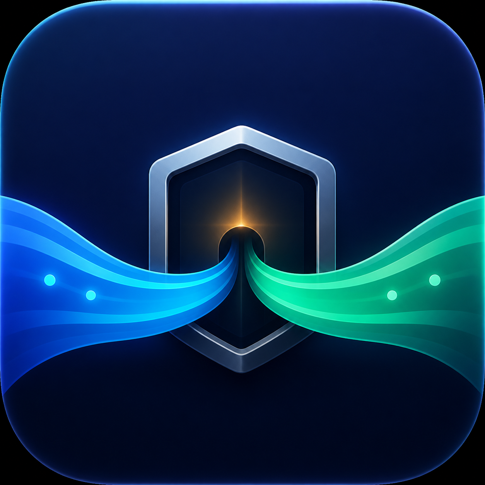

# Codex 代理启动器

<p align="center">
  
</p>

一个针对 Codex / ChatGPT macOS 桌面客户端的开源代理启动器。普通启动模式通过本机 Clash Verge 注入代理，不修改系统代理；可选的原生组件兼容模式使用可恢复的系统 PAC，覆盖新版电脑插件等不遵循进程代理参数的组件。

> 当前代码版本：0.3.1 · [已发布版本](https://github.com/ww1425680101/codex-proxy-launcher/releases/latest)

## 功能

- 通过 Clash Verge mixed port 单独启动 Codex。
- 每 2 秒统计 Codex 主进程及全部子进程的上下行流量。
- 显示实时速率、最近 3 分钟曲线、会话累计流量和活动代理连接数。
- 审计已建立的 TCP 连接，并在观察到外部直连时发出提示。
- 显示代理出口 IP、国家/地区、城市、ASN、运营商和时区。
- 同时提供完整仪表盘和菜单栏紧凑面板。
- Clash 代理端口不可达时拒绝启动 Codex，避免在启动阶段意外直连。
- 分别检测 Foundation 原生默认网络与显式 Clash 网络，不把端口可达当作电脑插件联网正常。
- 可选原生兼容代理：仅 OpenAI 相关域名经 Clash，其他域名直连；原有网络配置保留，正常关闭时恢复。

## 运行环境

使用预编译版本需要：

- Apple Silicon Mac（M1/M2/M3/M4 或更新机型）。
- macOS 13 Ventura 或更新版本。
- 已安装 Codex macOS 桌面客户端。
- 已安装并运行 Clash Verge，mixed port 为 `127.0.0.1:7890`。

Intel Mac 暂无预编译包。项目源码以 macOS 13 为最低目标，其他架构尚未经过验证。

## 安装

1. 打开 [Releases](https://github.com/ww1425680101/codex-proxy-launcher/releases) 页面。
2. 下载 `Codex-Proxy-Launcher-v0.2.0-macOS-arm64.zip`。
3. 解压后，将 `Codex 代理启动器.app` 移入“应用程序”文件夹或任意常用位置。
4. 第一次启动时按 macOS 的正常应用授权流程打开。

当前 Release 使用 ad-hoc 签名，没有 Apple Developer ID 公证。macOS 若阻止运行，可在“系统设置 → 隐私与安全性”中确认打开。请只从本仓库的 Releases 页面下载。

## 使用方法

1. 启动 Clash Verge，确认 mixed port 为 `7890`。
2. 关闭 Clash Verge 的 TUN 模式；macOS 系统代理也可以保持关闭。
3. 打开“Codex 代理启动器”。
4. 确认界面中的 Clash 状态显示为绿色。
5. 点击“启动 Codex（使用代理）”。如果 Codex 已经运行，启动器会先请求它正常退出，然后通过代理参数重新启动。
6. 在仪表盘中观察实时流量、活动代理连接和代理出口 IP。

如果 Codex 并非由本启动器打开，请点击“重启 Codex 并启用代理”，否则现有进程不会自动获得代理参数。

## 工作原理

### 原生组件兼容模式（0.3.0）

新版客户端的 `SkyComputerUseService` 使用原生网络栈。Electron 参数和代理环境变量不能保证它联网；实测故障为 `chatgpt.com/backend-api/aura/site_status` 请求超时。

仪表盘新增“电脑插件与原生组件”：当“显式代理可达、原生默认网络不通”时，可开启兼容代理。首次会打开本机授权终端，由 macOS `sudo` 读取管理员密码；启动器不会读取、保存或上传密码。授权启动的 `CodexNativeProxy` 是本次会话的助手进程，不安装常驻 LaunchDaemon，也不修改授权数据库或官方客户端二进制。

兼容模式会修改当前活动网络服务的 **PAC URL / 启用状态**。仅以下域名及其子域名经本机 Clash：

```text
chatgpt.com
openai.com
oaistatic.com
oaiusercontent.com
chatgptusercontent.com
```

其他域名返回 DIRECT；OpenAI 域名没有 DIRECT 回退。该系统域名策略会作用于同一网络上遵循系统代理的其他应用，并非按进程隔离。已有系统代理、PAC 或自动发现设置时拒绝覆盖。

PAC 服务只监听回环地址；停止与会话交接接口需要独立随机令牌。配置快照和控制令牌存放在管理员拥有的 `/Library/Application Support/CodexProxyLauncher/native-proxy-<uid>.json`，仅授权当前用户读取，不公开令牌。

关闭兼容模式、正常退出启动器、启动器进程消失、网络服务切换或 Clash 连续不可达时，助手恢复自己修改的 PAC 字段。其他程序改写 PAC URL 后不覆盖其设置。强制杀死助手或断电可能留下旧 PAC；再次授权启动助手时会先按可信恢复记录清理旧设置。

完整 `.app` 必须同时包含 `CodexProxyLauncher` 与 `CodexNativeProxy`。只有主二进制的旧包不能提供兼容模式。

诊断命令（不回显账号凭据或控制令牌）：

```sh
"Codex 代理启动器.app/Contents/MacOS/CodexNativeProxy" probe
"Codex 代理启动器.app/Contents/MacOS/CodexNativeProxy" status
"Codex 代理启动器.app/Contents/MacOS/CodexNativeProxy" stop
```

`probe` 的 HTTP 401 表示未认证请求已到达接口，只证明连通，不代表登录或实际电脑控制通过；仍须在真实 Chrome 中验证。

### 普通进程代理

启动器通过 macOS `NSWorkspace` 创建 Codex 进程，并注入两类配置：

- Electron `--proxy-server=http://127.0.0.1:7890` 参数，用于 Codex UI 的 HTTP、HTTPS 和 WebSocket 流量。
- `HTTP_PROXY`、`HTTPS_PROXY`、`ALL_PROXY` 及对应小写环境变量，供 Codex app-server 和支持代理环境变量的子进程继承。

流量仪表盘使用 macOS 自带的 `nettop` 读取进程累计字节数，并根据相邻采样计算速率；连接审计使用 `lsof` 检查 Codex 进程树已经建立的 TCP 连接。上述操作不需要管理员权限。

采样按每批最多 20 个 PID 分批执行，覆盖较大的客户端进程树。命令失败时显示采集异常和“—”，保留累计值及最后有效基线，不将失败画成零流量；恢复后的速率按实际间隔计算。

## 隐私说明

- 应用不收集账号、对话内容或访问日志，也不包含遥测和分析 SDK。
- 出口 IP 信息由 [`ipwho.is`](https://ipwho.is/) 提供，请求被强制通过配置的 Clash 代理发送。
- IP 查询会将代理出口 IP 暴露给该查询服务；显示的位置是网络数据库估算，不是设备 GPS 位置。
- Clash 不可达时，IP 查询不会回退到直连。

## 已知边界

这是进程启动器方案，不是 macOS Network Extension 或内核级防火墙：

- 普通模式仅覆盖 Electron 流量和遵循代理参数/环境变量的子进程；原生兼容模式的系统 PAC 另按上述域名覆盖。
- 原始 Socket、UDP/QUIC、SSH 或忽略代理环境变量的程序不受强制约束。
- 连接审计当前只覆盖已经建立的 TCP 连接，不等价于完整的防泄漏检测。
- Codex 启动后如果 Clash 退出，部分网络库是否回退直连取决于各自实现。
- 当前代理地址固定为 `127.0.0.1:7890`，尚未提供图形化配置入口。
- 兼容助手使用管理员网络配置权限，不能替代系统管理员授权；应保留完整签名应用，勿直接改写正在运行的助手。

## 从源码构建

需要 macOS 13 或更新版本，以及 Xcode Command Line Tools：

```bash
xcode-select --install
git clone https://github.com/ww1425680101/codex-proxy-launcher.git
cd codex-proxy-launcher
swift test
./Scripts/generate-icon.sh
./Scripts/build-app.sh release
```

构建产物位于：

```text
dist/Codex 代理启动器.app
```

测试：

```bash
swift test
```

## 项目结构

```text
Sources/CodexProxyLauncher/       SwiftUI 应用和仪表盘
Sources/CodexProxyLauncherCore/   启动、代理、流量与 IP 查询核心逻辑
Tests/                            单元测试
Assets/                           应用图标源文件和 .icns
Scripts/                          图标生成与 App 打包脚本
Packaging/                        Info.plist
```

## 许可证与声明

本项目采用 [MIT License](LICENSE) 开源。

本项目是独立的社区工具，与 OpenAI、Codex、Clash Verge 或其维护者不存在隶属或官方合作关系。相关产品名称和商标归各自权利人所有。
